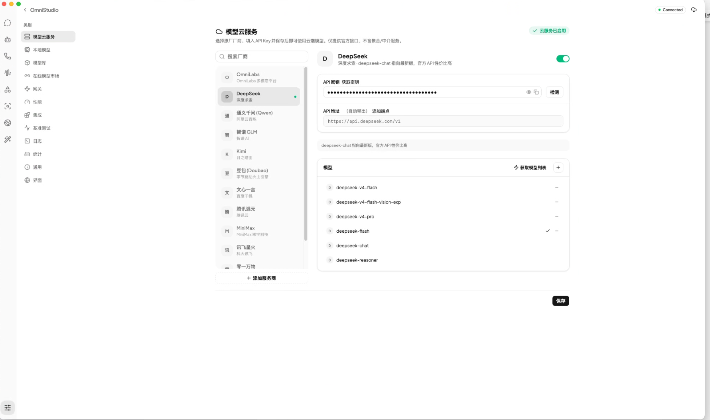
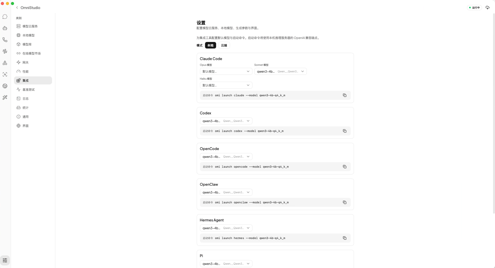
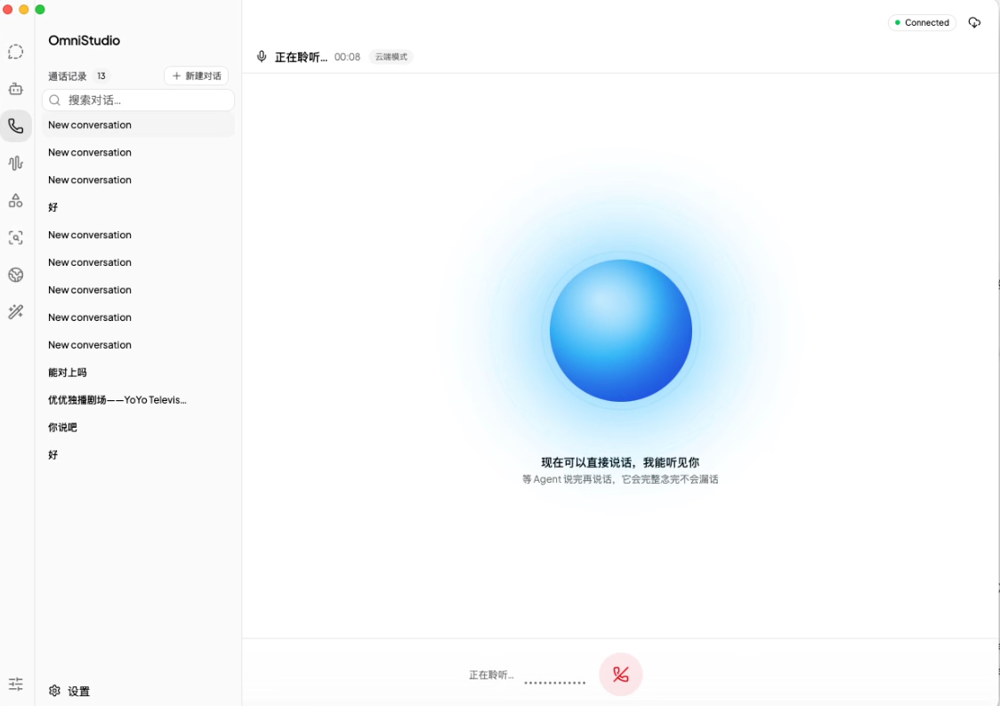
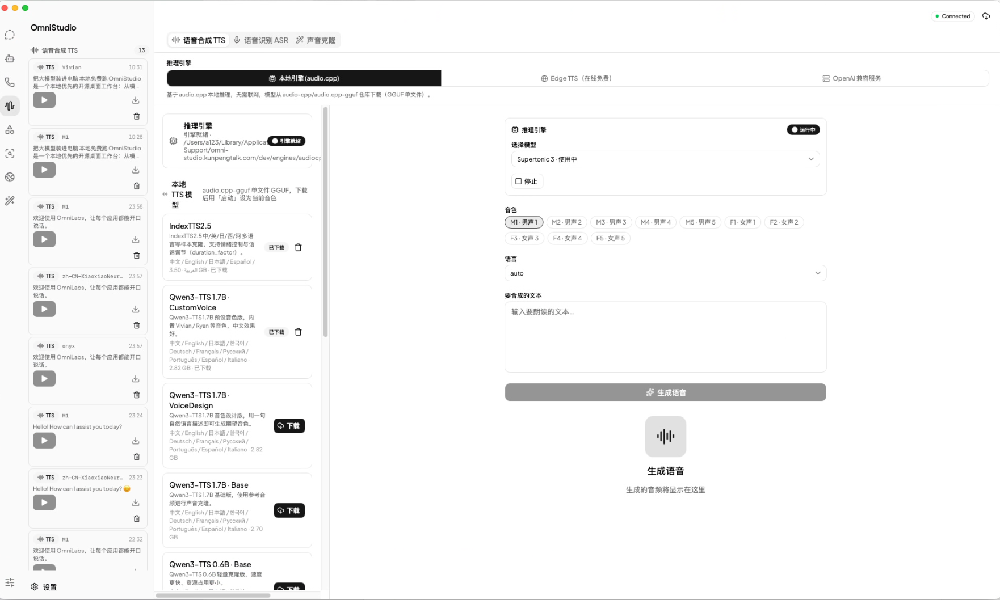
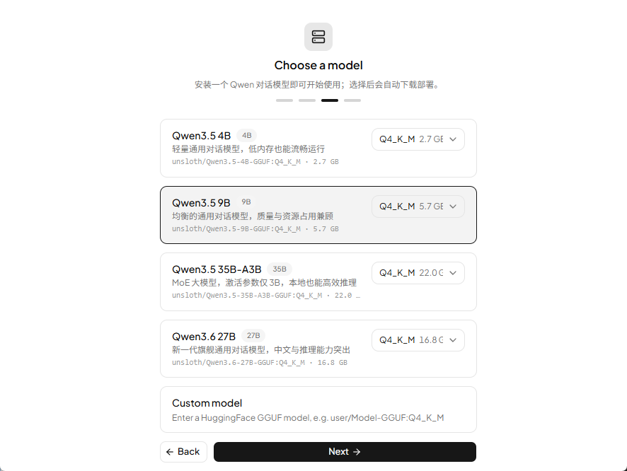

<p align="center">
  
</p>

<h1 align="center">OmniStudio</h1>

<p align="center">
  <b>A desktop workstation for local LLMs</b><br/>
  Manage models, run inference servers, and build with Chat / Voice / Image / Video / Music / OCR / Translate apps,<br/>
  plus a prompt plaza, mini apps, a local knowledge base, shared memory, and a Skills manager — all local-first.
</p>

<p align="center">
  <a href="./README.md">中文</a> · <b>English</b>
</p>

<p align="center">
  <a href="https://kunpengtalk.com">Website</a> ·
  <a href="https://kunpengtalk.com/assets/kunpengtalk-studio-demo.mp4">Demo</a> ·
  <a href="https://github.com/kunpengtalk/OmniStudio/releases/latest">Download</a> ·
  <a href="./CHANGELOG.md">Changelog</a>
</p>

<p align="center">
  ⭐ <a href="https://github.com/kunpengtalk/OmniStudio">Star</a> · License: <a href="LICENSE">MIT</a> · Author: 鲲鹏Talk
</p>

---

## 📸 Screenshots

One workbench covers the whole local-AI loop: the icon rail switches apps, the left panel picks a backend and its parameters, and the right side shows the result — every page shares the same layout.

### 🎨 Image generation · 🎬 Video generation

<table>
  <tr>
    <th align="center">Image · cloud API / local MLX / ComfyUI</th>
    <th align="center">Video · MiniMax H3 / Seedance / ComfyUI</th>
  </tr>
  <tr>
    <td></td>
    <td></td>
  </tr>
  <tr>
    <td>Switch between a cloud endpoint, the local MLX (mflux) engine on Apple Silicon, and ComfyUI on the same page; ratio / width / height / count are right there, every render lands in the history strip you can replay or download.</td>
    <td>Three backends behind one submit-then-poll flow: MiniMax H3 supports image-to-video from a first frame, while duration / aspect ratio / resolution / first frame all live in the left panel and finished clips go to a playable, downloadable history.</td>
  </tr>
</table>

### 🧰 Prompt Plaza · 🧩 Mini apps

<table>
  <tr>
    <th align="center">Prompt Plaza · Personal prompt library</th>
    <th align="center">Mini apps · one-task sandboxed tools</th>
  </tr>
  <tr>
    <td></td>
    <td></td>
  </tr>
  <tr>
    <td>638 image / 2,060 video / 35 LLM prompts, browsable by category (apps, marketing, posters, illustration, IP, art …) and by source, with full-text search; <b>Copy</b> takes the text, <b>Try it</b> routes to the Image / Video / Chat app with the prompt attached, and <b>Add to my prompts</b> keeps it in your own list.</td>
    <td>Seven self-contained pages — cutout, ID photo, mosaic, portrait, meeting notes, copywriter, notes; each card names the capabilities it needs (local cutout / chat model / ASR / image generation), and <b>Configure</b> fills in whatever is missing while the rest keeps working.</td>
  </tr>
</table>

### 📚 Knowledge base · 🧠 Memory

<table>
  <tr>
    <th align="center">Knowledge base · local RAG with citations</th>
    <th align="center">Memory · long-term store shared by every agent</th>
  </tr>
  <tr>
    <td></td>
    <td></td>
  </tr>
  <tr>
    <td>Four ingest paths — add files, import a directory, add a note, add a web page — with per-document chunk and embedding state; attach a knowledge base in chat and answers come back with <code>[n]</code> citations, while the gateway's <code>/mcp</code> exposes the same store to any MCP client.</td>
    <td>An overview (total, pinned, agent-written, retrieval hit rate, merged writes, blocked sensitive content) above the full list, with pinned entries injected into the system prompt; the <b>Enable memory</b> and <b>Confirm before writing</b> switches decide whether agents may write and whether you approve first.</td>
  </tr>
</table>

### 📊 Benchmarks


One run sweeps the whole matrix — context length (1K–1M) × concurrency × cache scenario (cold / partial / full hit) — and reports TTFT, TPOT, TPS, aggregate throughput and prefill per rung, with a **cache hit comparison** that turns the cold-versus-hit gap into a multiplier (a ×1 result means the server never hit its cache). Results are stored and can be exported to HTML.

### 🔢 JEV typed judgments


No generated text — it answers **constrained questions**: `noul` (yes/no), `choice` (pick one of your options), `score` (rate on an ordered rubric) and hands back probability distributions and confidence, which is what makes classification, tagging and scoring **comparable, thresholdable and batchable**. The left column switches between Local (install `laya-mlx`, download weights, start the model — all on this page) and Cloud, then holds the state and the question list; the right column shows each question's probability distribution. Five bilingual examples in the sidebar (ticket routing / resume scoring / content guardrails / reranking / intent routing) load straight into the left column, and you can also describe what you want in one sentence and let the chat model turn it into the request body. The protocol matches TypeSafe's official API field for field, so the official SDKs reach the local gateway by changing only `TYPESAFE_BASE_URL` and `TYPESAFE_API_KEY`.

### More screenshots

<table>
  <tr>
    <th align="center">Cloud Models</th>
    <th align="center">CLI Integrations</th>
  </tr>
  <tr>
    <td></td>
    <td></td>
  </tr>
  <tr>
    <th align="center">Voice · Live Talk</th>
    <th align="center">Text-to-Speech</th>
  </tr>
  <tr>
    <td></td>
    <td></td>
  </tr>
  <tr>
    <th align="center" colspan="2">Model Picker · Setup Wizard</th>
  </tr>
  <tr>
    <td colspan="2"></td>
  </tr>
</table>

---

## ✨ Features

### Model Hub

- **Search & browse** — ModelScope model search with repository file listings and detail pages (parameters, size, downloads, license, tags).
- **Full-format downloads** — GGUF (llama.cpp), safetensors (vLLM / SGLang), bin / pt / ckpt / onnx; single file or whole-repo "download all"; HuggingFace as the source for audio.cpp GGUF models.
- **Download manager** — Queue-based concurrent downloads with pause / resume / cancel, resumable transfer (HTTP 206), favorites, and multi-directory storage.
- **Capability categories** — Auto-classified as Chat / TTS / ASR / Image / Other and persisted, surfaced as badges and filters.

### Model Services

- **First-run wizard** — One-click Qwen3.5 4B / 9B / 35B-A3B and Qwen3.6 27B models that download and deploy automatically once selected; also supports a custom HuggingFace GGUF model.
- **Cloud model service** — Presets for 20 mainstream OpenAI-compatible providers (OmniLabs, DeepSeek, Qwen, Zhipu GLM, Kimi, Doubao, Wenxin, Hunyuan, MiniMax, iFlytek Spark, 01.AI, StepFun, SiliconFlow, OpenRouter, OpenAI, Anthropic, Gemini, and more), presented as a three-column **providers / configuration / models** panel: keep several provider profiles side by side and activate one with a click — the active profile is written back into the slots the gateway and `omi` CLI already read. Connectivity testing, live model-list fetching, and a **Default Models** page for per-purpose defaults.
- **Unified three-engine runtime** — llama.cpp (default: GGUF from local files or HuggingFace, GPU offload, KV cache quantization, multimodal mmproj), vLLM, and SGLang behind one abstraction with hot switching; or connect any OpenAI-compatible endpoint directly (remote mode).
- **Unified gateway** — A single local endpoint that routes each model to the local inference server or a cloud API, speaking Chat Completions / Responses / Anthropic Messages (including bidirectional tool calling); optional API-key auth, interactive OpenAPI docs, and `/v1`, `/health`, `/metrics` endpoints with one-click copy from settings; `/mcp` and `/v1/memories` expose the knowledge base and shared memory to external clients.
- **JEV typed judgments (free)** — Not text generation: it answers *constrained* questions — `noul` (yes/no probability), `choice` (pick one of your options), `score` (rate on an ordered rubric) — returning probability distributions and confidence. The wire protocol matches TypeSafe's official API field for field, so the official SDKs (`typesafe-sdk` / `@typesafe-ai/sdk`) reach the local gateway by changing only `TYPESAFE_BASE_URL` and `TYPESAFE_API_KEY`, which also lets other agents call it. Local-first backends: the managed `laya-mlx` runtime (Apple Silicon, fully offline and free) or a self-hosted TypeSafe-compatible server, with cloud TypeSafe as the fallback using your own key; the price is a constant 0. UI: the **JEV** page in the left rail (between Agent and Voice Call by default) — its left column switches between Local (install engine / download weights / start the model) and Cloud (base URL + key), the right column shows the probability distributions, and the sidebar carries five one-click examples (bilingual) plus copyable cURL / Python / JS snippets. The other two entry points are the `jev_evaluate` agent tool and `POST /v1/systemone` on the gateway. See [docs/jev-systemone.md](docs/jev-systemone.md).

### Built-in Apps

Every app shares one workstation layout: a global icon rail on the far left, a configuration panel on the left (engine switch / settings / input / primary action), and a result area on the right.

- **Chat** — streaming responses with reasoning display, image attachments (multimodal), web search (Bing / DuckDuckGo / Tavily with results injected as cited context), and text-file attachments; attach local knowledge bases to a message and answers come back with `[n]` citation traceability; auto-titled conversations, per-app session isolation, usage tracking.
- **Voice** — TTS from multiple sources (audio.cpp local engine, Edge-TTS, OpenAI-compatible TTS) plus a voice clone library, and multi-engine ASR (whisper.cpp / audio.cpp / OpenAI-compatible transcription); live listening conversations (cloud / local) with an embedded record player.
- **Image** — Generation via cloud OpenAI-compatible APIs, ComfyUI, or the local MLX (mflux) engine on Apple Silicon. MLX weights are pre-downloaded with live progress before generation, and the Prompt Plaza's **Try it** drops a prompt straight onto this page.
- **Video** — Three backends behind one submit-then-poll flow: MiniMax (H3, cloud, image-to-video from a first frame), Seedance (Volcano Ark content-generation tasks), and ComfyUI (local workflows); prompt / negative prompt / resolution / duration / seed / aspect ratio / watermark toggle plus first-frame upload, with finished clips kept in a history library you can play, download, or delete.
- **OCR** — Three engines: local Tesseract (one-click install, multilingual LSTM language packs, word/line bounding boxes), PaddleOCR (PP-OCRv6 resident worker, ~140 MB for the medium model), and VLM (Chandra / GLM-OCR / LightOnOCR). Upload PDF / images and get structured Markdown — GFM tables, KaTeX math, code blocks, captions, and bounding-box-cropped image regions — with a document queue and search.
- **Translate** — Switch between the current chat model (local / OpenAI-compatible) and the free Google endpoint across 22 languages, with source auto-detection, language swap, and one-click copy; **Live Translate** opens the microphone for real-time transcription (reusing all three ASR engines) and renders several target languages side by side.
- **Music** — Song, cover and vocal generation over two protocols, StepFun and MiniMax (the local-engine slot is reserved): the asynchronous one submits and polls, the synchronous one runs as a background job and backfills the record, and both land in the same table. The left column is a playlist library, the right side is the selected playlist's tracks, and a persistent player bar sits at the bottom; new songs join the default playlist automatically, album art is derived deterministically per track, and a playlist cover is a 2×2 mosaic of its first four tracks.
- **Prompt Plaza** — Two tabs, **Prompt Plaza** and **My prompts**: a personal prompt library with custom categories, create / edit / delete and full-text search; **Try it** routes to the Image / Video / Chat app with the prompt attached. (The previously bundled third-party aggregated prompts were removed on 2026-10-03; a hosted library may return through our own server.)
- **Mini apps** — Eight one-task sandboxed tools; each card on the home wall names the capability it needs and offers **Configure** when something is missing: **Background remover** (local ONNX engine, nothing uploaded, ~1s, recolor plus erase/restore brushing), **ID photo** (local portrait cutout resized to 20 specs — 1-inch, 2-inch, visa and more — with background swap and A4 print sheets), **Mosaic** (paint-to-redact with batch export, entirely on-device), **Portrait** (style presets for professional headshots and character avatars), **Meeting notes** (import or record audio → transcribe → agenda / conclusions / action items), **Copywriter** (multiple titles, selling points or scripts by purpose and tone), **Notes** (calendar and tag views, image attachments, bodies stored in the local database, optionally exposed to the agent read-only), and **Animated stickers** (one photo becomes a 16-piece still pack in a single art style, then a tap turns any piece into a looping GIF; the image model is picked inside the page — cloud models use the photo as reference, local engines draw from a description). Each mini app is one self-contained HTML page running in a sandboxed iframe **without** `allow-same-origin`, and the host grants capabilities one by one.
- **Knowledge Base (local RAG)** — Ingest local files (text read directly; PDF / images go through VLM OCR), handwritten notes, and web pages; Markdown-aware chunking (heading sections + greedy paragraph packing + overlapping hard splits) with optional embeddings (OpenAI-compatible `/v1/embeddings`), hybrid recall that fuses BM25 and cosine-vector rankings with RRF, and optional reranking (Jina / SiliconFlow / Cohere-compatible `/v1/rerank`); four tabs for recall testing, documents, access, and settings; no external vector store or FTS extension required.
- **Memory** — Long-term memory shared by every agent: built-in `memory_search` / `memory_save` / `memory_list` tools let agents store facts, preferences, and experience, and pinned or frequently used entries are injected into the system prompt; the same SQLite store is readable and writable through the gateway REST `/v1/memories`, MCP tools, and the `omi memory` CLI. The page shows totals, pinned / agent-written / updated-in-7-days / retrieval hit rate / merged writes / archived / blocked-sensitive counts, and carries two switches — **Enable memory** and **Confirm before writing** (the latter sends agent / CLI / MCP writes to a pending queue first).
- **Skills Manager** — One central skills repository (default `~/.agents/skills`) managed and synced into every coding tool, with 53 built-in tool adapters and symlink / copy sync modes; six sections: market (skillssh leaderboard), my skills, presets, projects, tools, and backup (Git remote, snapshots, auto-backup).

### Agents & Protocols

- **Pi Agent modes** — Agent / Plan (read-only tools, plan before acting) / Goal; the toolset is built-in file, shell, and search tools plus memory tools and tools from enabled MCP servers, and Plan mode automatically excludes tools with side effects.
- **MCP client** — Manage MCP servers from the settings **Tools** group over stdio, Streamable HTTP, or legacy SSE, with connectivity testing, tool enumeration, and JSON import; their tools are injected into the agent as `mcp_*`, and servers that fail to connect are skipped.
- **MCP server** — The local gateway exposes `POST /mcp` (stateless Streamable HTTP) so any MCP client — Claude Code, Cursor, and friends — can use the knowledge base (`kb_search` / `kb_list`) and memory (`memory_search` / `memory_save` / `memory_list`) as tools; opening `GET /mcp` in a browser gives you a built-in playground (connect → list tools → forms generated from each schema → call → raw JSON-RPC).
- **Three memory channels** — Built-in agent tools, the gateway REST / MCP endpoints, and the `omi memory` CLI all read and write the same SQLite store; `omi launch` refreshes the managed memory block in CLAUDE.md / AGENTS.md and mounts an `omni-memory` MCP server for Claude Code / Codex / OpenCode.

### Ops & Telemetry

- **Live dashboard** — Prefill / generation tokens and speed (tok/s), request counts, active models, memory and CPU load, uptime, and model disk usage (free / total of the volume holding the data directory) — polled every 2s.
- **Benchmarks** — Context-length (1K–1M) × concurrency × cache-scenario (cold / partial / full hit) sweeps reporting TTFT, TPOT, TPS, aggregate throughput and prefill per rung, plus a **cache hit comparison** that turns the cold-versus-hit gap into a multiplier (llama.cpp additionally reports how much of the prompt the server reused, so a ×1 result points straight at a server that never hit its cache). Runs against local or remote servers, stores every result, exports to HTML, and `omi benchmark --contexts 32k --cache cold,warm` drives the same matrix from the CLI.
- **Server logs** — Live tail with ANSI colors, auto-scroll, truncation guard, copy / clear.
- **CLI integrations** — One-click launch commands for Claude Code (local / cloud, Opus–Sonnet–Haiku mapping), Codex, OpenCode, OpenClaw, Hermes, Pi, and Copilot CLI, each bound to a default model and wired into shared memory.
- **Updates & i18n** — Stable / beta channels with in-app updates, automatic or manual update checks (the About page reports the latest release and links to the download), light / dark / follow-system themes, **a customizable left primary menu** (Settings → Appearance: drag to reorder, show or hide each entry — the order there is the order of the menu), a setup wizard, zh / en UI language, SQLite-backed session stores.

## 🚀 Getting Started

**Requirements**

- [Bun](https://bun.sh) 1.3+
- macOS (Apple Silicon); Linux / Windows support planned

```bash
bun install

# development with HMR (recommended)
cd apps/studio && bun run dev:hmr

# development without HMR
cd apps/studio && bun run dev

# build for production
cd apps/studio && bun run build:dev
```

## 💻 omi CLI

`omi` is a global command-line tool wrapping the backend: start the app, manage inference servers, configure cloud providers, pick models, launch coding tools, and read/write shared memory — **sharing the same database as the desktop app** (models, settings, and memory stay in sync).

```bash
cd apps/studio && bun link    # install the global omi command (~/.bun/bin)
omi help                       # list all commands
omi help <command> [sub]       # help for one command (e.g. omi help memory add)
omi guide                      # full manual: install, start, models, memory, coding tools

omi start --server             # start the app and bring up the inference server
omi model --select             # pick the active model in the terminal (--list only lists)
omi models                     # local + cloud model inventory; omi model-info <name> for detail
omi serve --port 8090          # run the inference server headless (foreground, CTRL+C to exit)
omi launch codex --model qwen3-4b-q4_k_m  # launch a coding tool on the current model (memory attached)
omi memory add "prefers pnpm"  # write to shared memory (same store the agents use)
omi memory search build-tools  # search memory
omi memory mcp                 # run as a stdio MCP server so coding tools share the same memory
omi server logs                # server log tail; omi install checks engine dependencies
omi status
```

How it works: the main process listens on a Unix socket in the data directory (`omni-control.sock`, mode 0600); `omi` uses that channel to focus the window, navigate, start/stop servers, and read/write settings. When the app is not running, `models` / `model-info` / `cloud` / `memory` fall back to reading the same SQLite database directly.

Docs: the full manual is [docs/omi-cli.md](./docs/omi-cli.md) (generated by `omi guide --md`, same source as Settings → Tools → Command line in the app); the legacy `omni` command (`chat` / `doctor` / `config` …) lives in [docs/omni-cli.md](./docs/omni-cli.md).

## 🧩 Tech Stack

| Layer | Technology |
|---|---|
| Desktop | [Electrobun](https://blackboard.sh/electrobun) + Bun |
| Frontend | React 19, Tailwind, shadcn/ui, Zustand, TanStack Query |
| AI | Pi Agent (`@earendil-works/pi-agent-core` + `pi-ai`) drives the agent loop; Vercel AI SDK (`ai` / `@ai-sdk/openai-compatible`) for one-shot OCR / translation calls |
| Inference engines | llama.cpp, vLLM, SGLang, MLX, OpenAI-compatible |
| Voice & OCR | audio.cpp, whisper.cpp, Tesseract, PaddleOCR, Edge-TTS, VLM |
| Video generation | MiniMax (H3), Seedance (Volcano Ark), ComfyUI |
| Knowledge base & memory | Pure-JS embeddings + BM25×RRF hybrid recall + `/v1/rerank` reranking (no external vector store / FTS), SQLite-backed shared memory |
| Protocols | MCP (hand-written client + Streamable HTTP server), Chat Completions / Responses / Anthropic Messages |
| Database | Drizzle ORM + Bun SQLite |
| Document processing | Sharp, pdfjs-dist, @napi-rs/canvas, Cheerio, Turndown |
| Model hub | ModelScope OpenAPI, HuggingFace |
| Build | Vite, Turborepo, Bun workspaces |
| Code quality | oxlint, oxfmt |

## 📁 Project Structure

```
apps/
├── studio/               # Electrobun desktop app
│   └── src/
│       ├── bun/            # Main process
│       │   ├── runtimes/   #   llama.cpp / vLLM / SGLang runtime abstraction
│       │   ├── vllm/       #   model profiles & endpoints
│       │   ├── db/         #   Drizzle schema, migrations, settings
│       │   ├── skills/     #   skills manager: central repo, sync, presets, backup
│       │   ├── control-server.ts  #   `omi` CLI ↔ app control channel (Unix socket)
│       │   └── ...         #   chat / voice / image / video / music / OCR / translation / knowledge (RAG) /
│       │                   #   memory / MCP (client + server) / model hub / downloads / stats / updates
│       ├── cli/            # `omi` command line (bin/omi.ts, reusing the bun data layer)
│       ├── mainview/       # React UI (components, stores, lib)
│       └── shared/         # shared constants, i18n, engine metadata
└── landing/                # Marketing site (kunpengtalk.com)
```

See [docs/architecture.md](./docs/architecture.md) for the full architecture (process boundaries, main-process layers, external interfaces, invariants, and known debt).

## 🗺 Roadmap

- [x] Model hub: ModelScope / HuggingFace downloads, queue, categories, favorites
- [x] Unified llama.cpp / vLLM / SGLang runtime + remote OpenAI-compatible API
- [x] Chat / Voice / OCR apps with per-app sessions; voice multi-engine TTS/ASR + cloning + records
- [x] Dashboard, benchmarks, log viewer, CLI integrations, update channels, i18n
- [x] Image generation loop for the Image app
- [x] `omi` CLI: launch app / server / cloud, model picking, launcher tools, status & logs
- [x] AI video generation (MiniMax / Seedance / ComfyUI) with task polling and history
- [x] AI music generation (StepFun / MiniMax, local engine reserved) — song / cover / vocal scoring
- [x] Local RAG knowledge base (hybrid BM25 + vector recall) with chat citations
- [x] Shared memory across agents (built-in tools, gateway REST / MCP, `omi memory`)
- [x] Skills manager: central repo, 53 tool adapters, presets, Git backup
- [x] Prompt library: personal prompt library with try-it routing + my-prompts list
- [x] Mini apps: 8 sandboxed single-page tools with per-capability gating
- [x] MCP both ways: client for external MCP servers + gateway `/mcp` server with playground
- [ ] Linux and Windows support
- [ ] More document formats (PowerPoint, Word, Excel, etc.)
- [ ] Memory lifecycle (idle unload, prefault protection), KV cache tiering with SSD offload
- [ ] Menu bar / Dock indicators, API key encryption

## 🩺 Troubleshooting

### Windows: the window opens but the content area is blank

**Symptom**: title bar and menu are there, the content area is one flat colour; the process is alive and the backend is healthy (`http://127.0.0.1:10000/health` responds).

**Cause**: WebView2's **GPU process keeps crashing**. Once Chromium gives up on the GPU it stops producing compositor frames — the page DOM is fully rendered, it just never gets painted ("a page, but no picture"). It is not a frontend or packaging problem, so an even cleaner payload will not help.

**Confirm** (optional): search `%LOCALAPPDATA%\omni-studio.kunpengtalk.com\<channel>\WebView2\Partitions\default\EBWebView\chrome_debug.log` for:

```
GPU process exited unexpectedly
GPU process isn't usable. Goodbye.
```

**Workaround**: force an in-process GPU by setting the env var before launching.

```powershell
# current session only, then launch OmniStudio from that terminal
$env:WEBVIEW2_ADDITIONAL_BROWSER_ARGUMENTS = "--in-process-gpu"
```

```bat
:: or persist it (then launch from the Start menu as usual)
setx WEBVIEW2_ADDITIONAL_BROWSER_ARGUMENTS "--in-process-gpu"
```

This flag only helps the GPU-crash flavour of a blank window. If the blank page comes from something else (e.g. a frontend module error) it will not help — for that, check the renderer console instead. Once the GPU driver or WebView2 is updated you can drop the variable and return to the default rendering path.

## 📄 License

MIT — maintained by 鲲鹏Talk. See [LICENSE](LICENSE).
